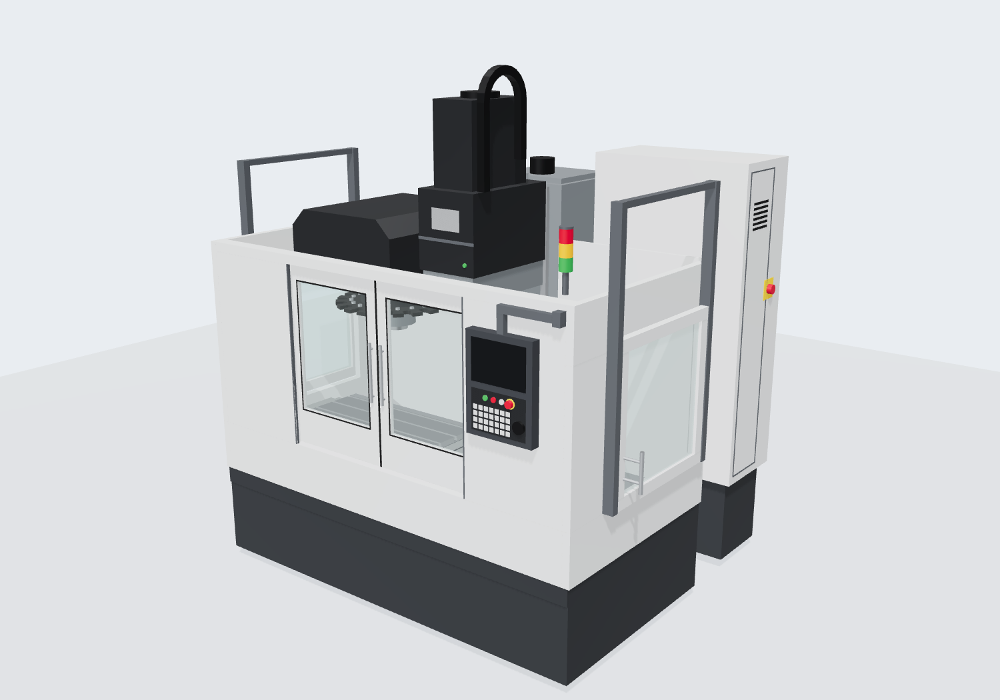
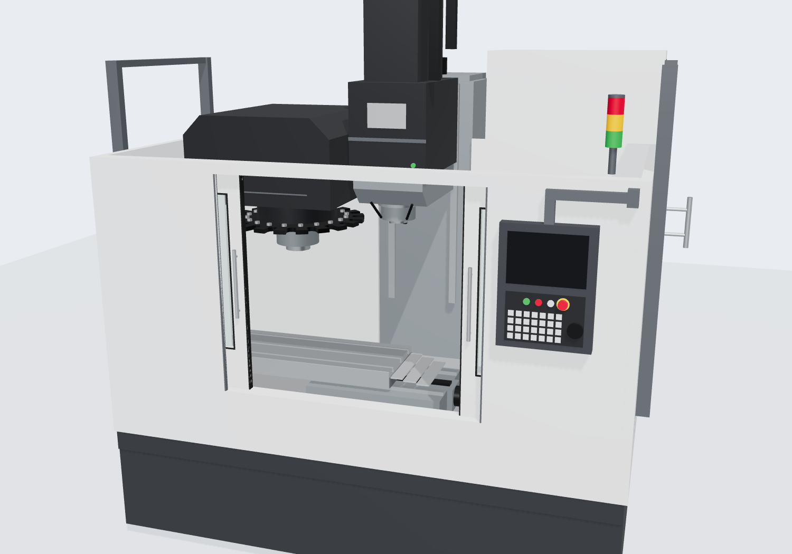
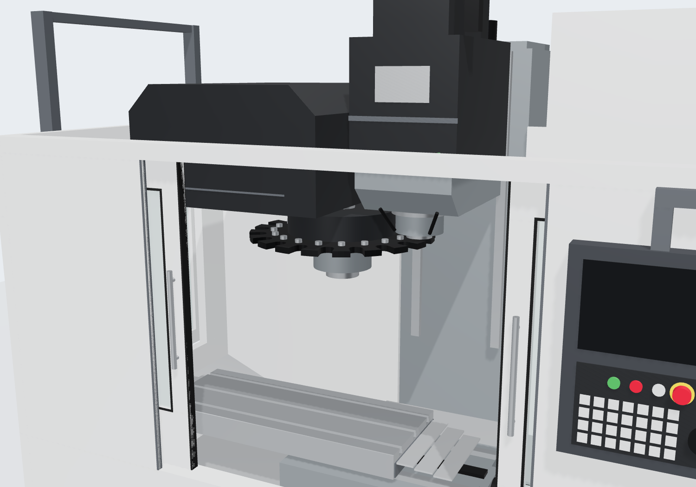

# Haas VF-2 — 独自形状の参照モデル

参照実機: **Haas VF-2**(40 番テーパの立形マシニングセンタ、行程 762 × 406 × 508 mm、傘形 20 本の工具交換装置)。
CC0-1.0。メーカーの CAD・メッシュ・図面・画像・ロゴは取り込まず、公表されている数値から形を一から著作した。
カタログ ID は `haas/vf/vf-2-reference/r1`(`machine_tool.vmc`、公開前)。

これは**形状パッケージ**で、包絡・行程・型式を持つ `haas/vf/vf-2`(kind: spec)の見た目になる。botrail では
`bt.parts.machine_tool(catalog="haas/vf/vf-2", shape="haas/vf/vf-2-reference", axes=True)` が、箱で立てた機械に
このリンクごとの形状を重ねる。当たり判定は包絡の箱のままで、ここの形状は絵である。



| 前扉と側面窓を開けたところ | 工具交換の姿勢 |
| --- | --- |
|  |  |

## 出典

2026-11-16〜17 参照。確認済みと推定の区分は [provenance.json](./authoring/provenance.json)。

- **[図面]** Haas [Machine Layout Drawing VF-2/VF-2SS/VF-2TR](https://www.haascnc.com/content/dam/haascnc/pdp_feed/mld/vf-2_mld__1_2023.pdf)
  (1/17/2023、6 ページ)。**数値だけ**を採った。図面そのもの(線・絵)は複製していない。図面は板金の積み上げ寸法で
  ±13 mm のばらつきがあると注記している。
- **[パック]** 公開カタログの `haas/vf/vf-2/r2`(CC0 の数値)。図面に寸法が無い値で、パックがメーカー配布の 3D モデルを
  **測って数値として**収載したもの(奥行、テーブル天面の高さ、主軸の前後位置など)。3D モデルは測定器としてだけ使われ、
  その形状・メッシュ・派生物はこのリポジトリにもパックにも入っていない。
- 外観の配色(明るい灰の外装、暗い台座と主軸頭カバー)は、製品ページの写真を目視した一般的な印象。画像は同梱していない。

| 項目 | 公表値 | 出所 | 本モデル |
| --- | --- | --- | --- |
| 出荷幅 | 2,316 mm | 図面 p.1 | 外装の側壁の外面 ±1,158(テストで固定) |
| 運転高さ | 2,724 mm | 図面 p.1 | 機械原点(主軸頭が上端)でのケーブルベアの上端(テストで固定) |
| レベリングパッド | 76 mm | 図面 p.1 | パッド 4 個。**位置は推定**(アンカーの範囲内) |
| 外装の高さ | 1,742 + 76 = 1,818 mm | 図面 p.1 | 外装の上端。上は開いている |
| 奥行(外装前面〜電装箱背面) | 1,984 mm | パック | 前面 −992 〜 電装箱の背面 +992 |
| 行程 X / Y / Z | 762 / 406 / 508 mm | 図面 p.4 | 関節 `x`・`y`・`z` の範囲(テストで固定) |
| 早送り | 25.4 m/min | パック(2013 年版カタログ) | 関節の速度上限 0.42333 m/s |
| テーブル | 914 × 368 mm | 図面 p.5 | テーブルの天面(テストで固定) |
| T 溝 | 16 mm × 3 本、ピッチ 125 mm、0.628 / 1.06 / 0.420 / 0.640 in | 図面 p.5 | 溝を実形状で切っている(幅 15.95 → 26.92、深さ 10.67 + 16.26) |
| テーブル天面の高さ | 853 mm | パック | `table` フレームの高さ |
| 主軸端面〜テーブル | 102〜610 mm | 図面 p.4 | `head` フレーム(主軸端面)の高さ: 原点で 1,463、下端で 955 |
| 主軸の位置 | 機内中心から後ろへ 101 mm | パック | 機体の中心線上、前面から 730.5 mm |
| 機械原点のテーブル | 主軸から左へ 381・前へ 211.5 mm | パック(図面 p.4 は 75 + 半幅 / 212) | 原点 = テーブルが左前、主軸頭が上端 |
| 前扉の通り幅 | 939 mm | 図面 p.3 | 2 枚が 469.5 mm ずつ開いて 939(テストで固定) |
| 前扉の下端 | 817 mm | 図面 p.3 | 開口の下端 |
| 前扉の高さ・板金の開口 | 954 mm・1,129 mm | パック | 開口 817〜1,770、板金の開口 ±564.5 |
| 側面扉 | 幅 677、下端 818、上端 1,413 mm | 図面 p.3 | 開口の幅と下端。窓は 595 mm 上がり、上げた窓の下端が 1,413 |
| 側面の開口の高さ・位置 | 749 mm、機内中心から後ろへ 50 mm | パック | 開口 818〜1,567 |
| 側壁の長さ | 1,199 mm | パック(図面 p.3 は 1,191) | 側壁は前面から 1,199 で終わる |
| 台座の上端 | 544 mm | 図面 p.3 | 暗い台座と明るい外装の境 |
| ペンダント | 高さ 1,411 mm | 図面 p.3 | ペンダントの中心の高さ |
| 電装箱 | 上端 2,247 mm、扉 906 / 339 mm | 図面 p.3 | 背面の箱の幅 906、上端 2,247。**奥行 470 と下端 520 は推定** |
| 工具交換装置 | カルーセル中心〜主軸 522、工具円 Ø585、半径 331、行程 230、20 本 | 図面 p.6 | `tool_shuttle` と `tool_carousel`(下記) |
| 工具交換装置の下端 | テーブル上 476 / 444 mm | 図面 p.6 | ハブの下端 |
| 質量 | 3,539 kg | パック | 入れない(リンク別の質量・慣性は省略) |

## リンクと関節

botrail の `machine_tool` と、メーカーの 3D モデルから起こした `haas/vf/vf-2-cad`(配布しない)と同じ約束。

- **`body`**(根): 動かないもの全部。フレームが機械のフレームで、機体の箱の中心の床上、前が −Y、右が +X、Z が上。
- **`y`**: `body` → `saddle`。**`x`**: `saddle` → `table`。**`z`**: `body` → `head`。関節の値が機械座標で、
  機械原点で 0、負の側へ動く(X・Y はテーブルが動き、Z は主軸頭が動く)。`table` のフレームはテーブル天面の中心、
  `head` のフレームは主軸端面の中心。
- **`front_door_left` / `front_door_right`**: 閉が 0、外へ 469.5 mm。開けると前面の外板と内張りの間に収まる。
- **`side_door_left` / `side_door_right`**: 上へ滑る窓。閉が 0、+595 mm で開く。
- **`tool_shuttle`**(直動、+X へ 0〜229.5 mm)と **`tool_carousel`**(Z 回りの回転、continuous): 傘形の工具交換装置。
  カルーセルのフレームは回転軸上で、高さは主軸端面と同じ(工具のゲージ面)。0 のときポケットの 1 つが主軸側(+X)を
  向き、シャトルが端まで寄るとそのポケットが主軸の真下に来る。
  botrail の `machine_tool(shape=)` はこの 2 関節を機械の機構に足し、制御が NC プログラムの工具交換のたびに動かす
  (シャトルが寄る → カルーセルが次の工具のポケットを主軸へ回す → シャトルが戻る)。主軸側を向くポケットが 1 番で、
  n 番は関節の正の回転方向に n − 1 個先。ポケットの数はカタログのマニフェストの `specs.tool_capacity`(20)から読む。
  表示だけで、当たり判定には入らない。

## 表現範囲と仮定

- **推定**(公表値が無いもの): 側壁の厚さ 40 mm、前面の外板 12 mm と扉の収まる隙間、扉の板の幅 600 mm と取っ手、
  台座・サドル・コラム・主軸頭の鋳物とカバーの形と寸法(主軸端面から主軸頭の下面までの 98 mm は図面 p.4 の
  「3.9 in [98 mm]」をそう読んだもので、何の寸法かは図面からは断定できない)、
  工具交換装置の覆いと支え、カルーセルの板厚とポケットの幅 46 mm、電装箱の奥行、潤滑パネル、ペンダントの大きさ
  (幅 360 × 高さ 480)、表示灯。図面 p.4 のテーブル端〜内壁 304 / 271 mm は、この壁厚では 280 / 280 になる。
- **図面の丸め**: 工具交換装置の行程は 229.5 mm にした。図面は 20.6 in − Ø23 in / 2 = 9.1 in を「9 in [230 mm]」と
  印字している(テストは印字値の ±1 mm)。
- **側面の窓**は壁の外側を上がる板として描いた(レール 2 本と横桟つき)。`haas/vf/vf-2` の包絡がそう立てるのに合わせた
  もので、自動窓の実際の機構は確認していない。左右とも同じ形で、パックでは自動窓は右側面だけ。
- **ペンダント**は前面の右の外板の前に置いた。押しボタン 4 つ(サイクルスタート、フィードホールド、リセット、非常停止)は
  包絡の生成器がボタンを置く位置(高さ 1,357 mm)に合わせてある。
- **絵にしていないもの**: チップシュートとクーラントタンク(出荷幅 2,316 mm の外に出る。運転幅は 3,147 mm、
  運転奥行は 2,249 mm)、オプション品(排気装置、上部の窓、コンベア、サイドマウント式工具交換装置)、
  ポケットの工具、テレスコカバーの伸縮、ロゴと銘板。
- **衝突**: 各リンクに箱と円柱だけ(外装は開口を残した板、コラム、電装箱、覆い、ペンダント、テーブル、主軸頭、
  扉の板、カルーセル)。保証された包絡ではない。botrail の `machine_tool` は絵としてだけ使い、検証は
  `haas/vf/vf-2` の包絡で行う。
- **材質**: 色と粗さだけの名前付き材質。窓ガラスは透過(MTL の `d 0.3`)。

## 再生成・表示

```sh
npm --prefix haas-vf-2/authoring ci
npm --prefix haas-vf-2/authoring run export
npm --prefix haas-vf-2/authoring test
npm --prefix haas-vf-2/authoring run check
```

`authoring/index.html` を `haas-vf-2/authoring` から HTTP 配信すると、3 軸・前扉・側面窓・工具交換装置の
スライダ付きで表示できる。
